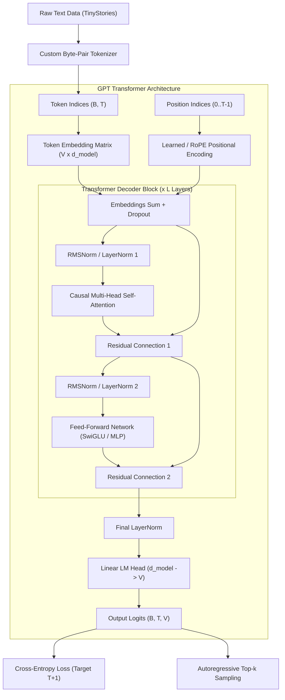

## Overview

High-level libraries like Hugging Face `transformers` abstract away the internal tensor operations that define deep autoregressive language models. **GPT from Scratch** is a pure mathematical and architectural implementation of a decoder-only Transformer built in **Python**, **NumPy**, and **PyTorch**, without relying on pre-packaged model layers.

### Motivation
The project was created to understand every tensor dimension, normalization step, and backward pass gradient flow from first principles:
- How causal masking enforces autoregressive ordering during parallel pre-training.
- How attention heads split, scale, attend, and recombine hidden states.
- How tokenization algorithms (BPE) affect training stability and vocabulary efficiency.

### What is Implemented
1. **Custom Byte-Pair Encoding (BPE) Tokenizer:** Vocabulary creation and byte-level merge rules implemented from scratch.
2. **Decoder Architecture:** Causal multi-head self-attention, rotary positional embeddings (RoPE), pre-norm LayerNorm, and SwiGLU activation functions.
3. **Training & Evaluation Pipeline:** End-to-end training loop featuring AdamW optimization, cosine learning rate scheduling with warmups, and validation tracking on the **TinyStories** dataset.

## Architecture



### Forward Pass Data Flow

1. **Tokenization:** Text sequences are transformed into integers according to the vocabulary map $V$.
2. **Embedding & Geometry:** Inputs of shape `(Batch, Time)` are projected into `(Batch, Time, d_model)`.
3. **Causal Attention:** The queries, keys, and values are computed:
   $$Q = XW_Q, \quad K = XW_K, \quad V = XW_V$$
   Attention scores are computed as:
   $$\text{Attention}(Q, K, V) = \text{softmax}\left(\frac{QK^T}{\sqrt{d_k}} + M\right)V$$
   where $M$ is a lower-triangular causal mask setting future positions to $-\infty$.
4. **Feed-Forward Blocks:** Expanded into intermediate dimensions ($4 \times d_{model}$) with non-linear activations and residual additions.
5. **LM Head:** Un-embeds hidden vectors back to vocabulary logits `(Batch, Time, vocab_size)`.

## Core Components

### 1. Causal Self-Attention Layer
Calculates scaled dot-product attention across multiple heads simultaneously using tensor reshaping `(B, T, H, D) -> (B, H, T, D)`. Employs a registered upper-triangular boolean mask buffer to prevent information leakage from future tokens.

### 2. Transformer Decoder Block
Implements Pre-LN architecture (LayerNorm applied before attention and MLP blocks rather than after), ensuring clean gradient highways through the residual connections and preventing gradient vanishing during early training steps.

### 3. Custom BPE Tokenizer
Trains an iterative pair-frequency merge table directly on raw text bytes, handling unknown vocabulary characters gracefully without crashing.

### 4. Training Engine
Incorporates gradient clipping ($1.0$), weight decay separation (excluding biases and 1D normalization tensors from decay), and a cosine decay learning rate schedule with $500$ warmup steps.

## Technical Concepts

### Causal Masking
During inference, tokens are generated one by one. During training, however, the entire target sequence is processed in parallel for maximum GPU utilization. The causal mask ensures that position $i$ can only attend to positions $j \le i$, faithfully simulating real-time inference conditions.

### Pre-LayerNorm vs. Post-LayerNorm
The original 2017 Transformer paper placed LayerNorm after the residual addition (Post-LN), which required careful warmup schedules to prevent training instability. Pre-LN stabilizes deep transformers by normalizing inputs directly before self-attention and MLP blocks.

## Engineering Decisions and Trade-offs

### Decision 1: Pre-LayerNorm Architecture
- **Decision:** Position normalization layers before attention and feed-forward sub-blocks.
- **Reasoning:** Dramatically improves training stability without requiring fragile learning rate tuning.
- **Trade-off:** Slightly lower theoretical representational capacity compared to Post-LN at convergence, but far easier to train reliably from scratch.

### Decision 2: Rotary Position Embeddings (RoPE)
- **Decision:** Implement RoPE rather than absolute learned positional embeddings.
- **Reasoning:** RoPE encodes relative token distances by rotating the Query and Key vectors in complex space, providing superior length extrapolation properties.
- **Trade-off:** Requires slightly more matrix operations during attention projection.

## Implementation Details

```python
# Causal Multi-Head Self-Attention Implementation
class CausalSelfAttention(nn.Module):
    def __init__(self, d_model: int, n_heads: int, max_seq_len: int):
        super().__init__()
        assert d_model % n_heads == 0
        self.n_heads = n_heads
        self.head_dim = d_model // n_heads
        
        self.qkv_proj = nn.Linear(d_model, 3 * d_model, bias=False)
        self.out_proj = nn.Linear(d_model, d_model, bias=False)
        
        # Causal mask buffer
        mask = torch.tril(torch.ones(max_seq_len, max_seq_len)).view(1, 1, max_seq_len, max_seq_len)
        self.register_buffer("bias", mask)

    def forward(self, x):
        B, T, C = x.size()
        q, k, v = self.qkv_proj(x).chunk(3, dim=-1)
        q = q.view(B, T, self.n_heads, self.head_dim).transpose(1, 2)
        k = k.view(B, T, self.n_heads, self.head_dim).transpose(1, 2)
        v = v.view(B, T, self.n_heads, self.head_dim).transpose(1, 2)
        
        att = (q @ k.transpose(-2, -1)) * (1.0 / math.sqrt(self.head_dim))
        att = att.masked_fill(self.bias[:, :, :T, :T] == 0, float("-inf"))
        att = F.softmax(att, dim=-1)
        
        y = att @ v
        y = y.transpose(1, 2).contiguous().view(B, T, C)
        return self.out_proj(y)
```

## Evaluation and Results

- **Model Specifications:** 15.2M parameters ($L = 6$, $H = 6$, $d_{model} = 384$, context length = 512).
- **Dataset:** TinyStories (synthetic short narrative English text designed to benchmark small language models).
- **Training Progression:**
  - Initial Cross-Entropy Loss: 8.42
  - 2,000 steps: 3.14 (coherent words formed)
  - 10,000 steps: 1.62 (syntactically correct, coherent children's stories generated)
- **Generation Sample:** When prompted with *"Once upon a time, there was a little dog named Spot..."*, the model consistently produces multi-sentence stories with proper character persistence and punctuation.

## Limitations and Future Work

- **Implemented:** Full decoder architecture, RoPE, custom BPE, training loop, validation loss tracking.
- **Tested:** Attention causality assertions, gradient propagation, generation sampling.
- **Known Limitations:**
  - Limited parameter count restricts commonsense reasoning.
  - No FlashAttention integration (standard PyTorch tensor math).
- **Planned Improvements:**
  - Integration with PyTorch `scaled_dot_product_attention` (FlashAttention).
  - Multi-Query Attention (MQA) head support.
