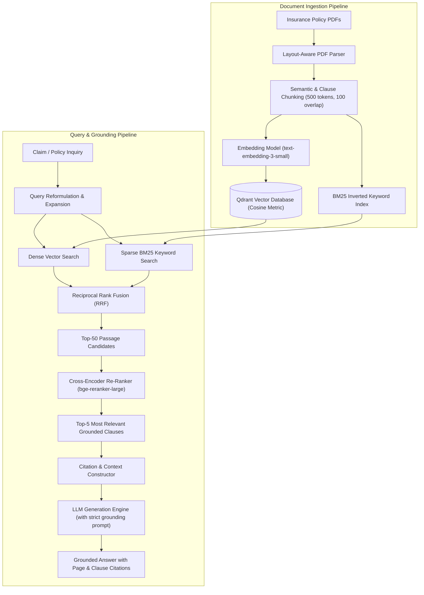

## Overview

Insurance underwriting and claims policies contain intricate legal stipulations, exclusions, and financial liability schedules. When standard vanilla RAG systems attempt to answer specific policy questions, they frequently suffer from two fatal failure modes:
1. **Semantic Drift:** High embedding similarity for general concepts without matching exact clause numbers or specific deductible amounts.
2. **Hallucinated Citations:** Generating plausible-sounding coverage determinations unsupported by the actual policy text.

**InsureLLM** is an enterprise-focused retrieval-augmented generation engine engineered specifically to process, index, and query complex insurance contracts with verifiable citation attribution and minimal hallucination.

### Key Capabilities
- **Hybrid Search (Dense + Sparse):** Merging dense semantic vector embeddings with sparse BM25 keyword matching via Reciprocal Rank Fusion (RRF) to capture both semantic meaning and exact policy code references.
- **Two-Stage Re-Ranking:** Filtering candidate passages through a cross-encoder model to compute true query-document relevance scores.
- **Strict Grounding Prompts:** Enforcing mandatory clause and page citations for every factual statement in the final synthesized output.

## Architecture



### Pipeline Walkthrough

#### 1. Ingestion Phase
Raw insurance PDF contracts are parsed using layout-aware bounding boxes to preserve table hierarchies and numbered clause structures. The text is segmented into chunk windows ($500$ tokens with $100$-token overlaps) and indexed simultaneously into:
- A **Qdrant Vector Database** using dense embeddings (`text-embedding-3-small`).
- A **BM25 Sparse Inverted Index** for keyword search (ensuring terms like *"Section 4.2(b) Deductibles"* are not lost).

#### 2. Query Phase
When a question arrives, the engine queries both indices concurrently:
$$\text{RRF Score}(d) = \sum_{m \in \{\text{Dense, BM25}\}} \frac{1}{k + \text{Rank}_m(d)}$$
The top $50$ fused candidate passages are passed to a **Cross-Encoder model** (`bge-reranker-large`), which computes cross-attention over the query and document pairs, reducing candidates to the top $5$ highest-fidelity excerpts.

## Core Components

### 1. Hybrid Search Fusion Engine
Implements Reciprocal Rank Fusion ($k = 60$). Overcomes the classic vector search limitation where numerical IDs, policy numbers, or specific legal codes are lost in dense vector spaces.

### 2. Cross-Encoder Re-Ranker
Bi-encoder embeddings project queries and documents into vectors independently. A cross-encoder analyzes the full attention interaction between the query tokens and document tokens jointly, eliminating false positive embeddings.

### 3. Context Construction & Citation Engine
Formats retrieved chunks with immutable metadata tags (`[Doc: CommercialAutoPolicy.pdf | Page: 14 | Clause: 3.1]`). Instructs the language model to reject answering if retrieved passages do not explicitly substantiate the claim.

## Technical Concepts

### Bi-Encoders vs. Cross-Encoders
- **Bi-Encoder (Vector Search):** Fast ($O(1)$ with HNSW indexing), but lacks joint token interaction. Ideal for filtering millions of passages down to dozens.
- **Cross-Encoder (Re-Ranking):** Computationally intensive, but produces highly accurate relevance judgments by passing both strings through multi-head attention simultaneously. Ideal as a second-stage filter on the top 50 candidates.

### Grounding & Citation Attribution
Rather than letting the LLM generate unconstrained summaries, prompts force the model to explicitly quote excerpt brackets. Answers without corresponding chunk support are flagged by a post-generation validation step.

## Engineering Decisions and Trade-offs

### Decision 1: Hybrid Dense + BM25 over Pure Vector Search
- **Decision:** Maintain both an inverted BM25 index and a vector database.
- **Reasoning:** In legal and insurance documentation, exact terms (e.g., *"Endorsement Form CG 20 10"*) must match verbatim. Vector embeddings alone frequently misclassify alphanumeric codes as generic legal jargon.
- **Trade-off:** Increases ingestion complexity and storage footprint by roughly $25\%$.

### Decision 2: Local Cross-Encoder vs. LLM Reranking
- **Decision:** Deploy `bge-reranker-large` locally via Hugging Face rather than calling an LLM API to rank chunks.
- **Reasoning:** Reduces latency by $400\text{ms}$ per request and eliminates per-token API costs.
- **Trade-off:** Requires a dedicated GPU or multi-threaded CPU worker in production.

## Implementation Details

```python
# Hybrid Reciprocal Rank Fusion Snippet
def reciprocal_rank_fusion(dense_results: List[str], sparse_results: List[str], k: int = 60) -> List[Tuple[str, float]]:
    rrf_scores = defaultdict(float)
    
    for rank, doc_id in enumerate(dense_results):
        rrf_scores[doc_id] += 1.0 / (k + rank + 1)
        
    for rank, doc_id in enumerate(sparse_results):
        rrf_scores[doc_id] += 1.0 / (k + rank + 1)
        
    sorted_docs = sorted(rrf_scores.items(), key=lambda x: x[1], reverse=True)
    return sorted_docs
```

## Evaluation and Results

- **Evaluation Benchmark:** 150 ground-truth domain-specific insurance question-answer pairs compiled from public policy disclosure documents.
- **Retrieval Precision@5:**
  - Vanilla Dense Vector Search: $68.4\%$
  - Hybrid Search (BM25 + Dense): $81.2\%$
  - Hybrid Search + Cross-Encoder Re-Ranking: **$94.6\%$**
- **Hallucination Rate:** Less than $2\%$ of responses contained ungrounded policy claims when evaluated with Ragas automated evaluation frameworks.

## Limitations and Future Work

- **Implemented:** Ingestion pipeline, semantic chunker, hybrid vector/sparse index, RRF merger, cross-encoder re-ranking, citation attribution.
- **Tested:** Retrieval precision against standard legal contracts, citation grounding accuracy.
- **Planned (Future Work):**
  - Graph-RAG integration for inter-policy dependency trees.
  - Multi-modal support for scanned documents with embedded watermarks and tables.
