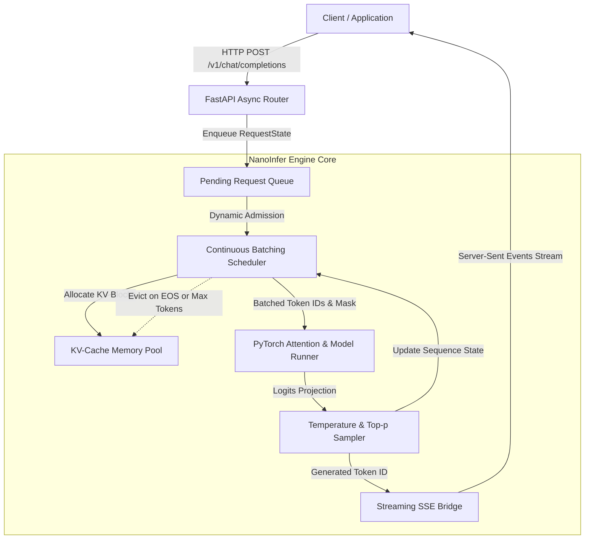

## Overview

Modern large language models require specialized serving infrastructure to balance low-latency single-user generation with high-throughput multi-user concurrency. **NanoInfer** is a lightweight, ground-up LLM inference server designed to demystify and benchmark the core systems innovations pioneered by production engines like vLLM and TensorRT-LLM.

### The Problem Addressed
Standard deep-learning serving pipelines rely on static batching. When requests of varying lengths arrive concurrently, static batching pads all inputs to the longest sequence and executes iterations until every request terminates. Shorter requests are forced to wait for longer ones, wasting valuable GPU compute on idle padding cycles. Furthermore, repeated autoregressive generation recalculates the entire context's Key and Value tensor representations at every step without caching, resulting in quadratic $O(N^2)$ computational overhead.

### What NanoInfer Does
NanoInfer implements:
1. **Chunked Key-Value (KV) Caching:** Eliminating redundant attention computations across autoregressive generation iterations.
2. **Iteration-Level Continuous Batching:** Scheduling incoming requests into active GPU forward passes at iteration boundaries rather than waiting for an entire batch to complete.
3. **Asynchronous Token Streaming:** Delivering low Time-to-First-Token (TTFT) via Server-Sent Events (SSE).

### Scope and Boundaries
NanoInfer is an experimental systems implementation built to profile architectural bottlenecks. It implements the scheduling loop, KV cache tensor management, and streaming APIs from scratch in Python and PyTorch. It relies on Hugging Face model weights for the underlying matrix weights (e.g., TinyLlama-1.1B, Llama-3-8B). It does not implement custom fused CUDA kernels or multi-node tensor parallelism, which are left for production deployments.

## Architecture



### Request Lifecycle and Data Flow

1. **Ingestion & Tokenization:** The client submits a prompt over HTTP. The FastAPI router validates the payload, tokenizes the prompt text, constructs an internal `RequestState` object, and enqueues it.
2. **Scheduler Batch Assembly:** At each discrete iteration step, the engine scheduler checks available GPU memory in the KV Cache Pool. If sufficient blocks exist, pending requests are promoted into the active batch.
3. **Prefill vs. Decode Phase Execution:**
   - **Prefill (Prompt Processing):** For newly admitted requests, the model processes the entire prompt tokens in parallel, populating their initial KV cache slots.
   - **Decode (Token Generation):** For running requests, only the single most recent token ID is passed to the attention layers along with KV cache pointers.
4. **Sampling & Stream Emission:** The final layer logits are sampled (Greedy or Top-p). The sampled token ID is pushed onto an asynchronous queue connected to the client's SSE response stream.
5. **Eviction:** When a sequence outputs an `<eos>` token or exceeds its maximum token budget, its KV blocks are deallocated back to the pool immediately.

## Core Components

### 1. Continuous Batching Scheduler
The scheduler orchestrates iteration-level stepping. Rather than holding a lock across an entire multi-token generation session, the scheduler executes one forward pass per iteration, adjusts batch membership dynamically, and returns control to the asynchronous event loop.

### 2. Chunked KV Cache Pool
Pre-allocates a contiguous tensor buffer on GPU memory shaped `(num_layers, 2, num_blocks, block_size, num_heads, head_dim)`. A block table tracks logical-to-physical block mappings, mitigating fragmentation without allocating memory for max sequence length upfront.

### 3. Asynchronous Model Runner
Wraps PyTorch attention mechanisms. Supports passing prefill sequences alongside decode sequences using packed 1D tensor formats and attention offset masks.

### 4. Streaming Tokenizer Bridge
Decodes token IDs into string fragments incrementally using UTF-8 byte buffering to ensure multi-byte unicode characters are not split across SSE packet boundaries.

## Technical Concepts

### KV Caching in Autoregressive Attention
In scaled dot-product attention:
$$\text{Attention}(Q, K, V) = \text{softmax}\left(\frac{QK^T}{\sqrt{d_k}}\right)V$$
During autoregressive decoding at step $t$, the query $Q_t$ represents only the current token. Since the keys and values of previous tokens $1 \dots t-1$ do not change, saving them in GPU memory avoids recalculating $K$ and $V$ projections for all past tokens at every step.

### Time to First Token (TTFT) vs. Inter-Token Latency (ITL)
- **TTFT:** The latency from request submission to the emission of the first generated token. Dominated by the compute-bound prefill phase.
- **ITL:** The delay between consecutive generated tokens. Dominated by memory-bandwidth-bound matrix-vector multiplications during decode passes.

## Engineering Decisions and Trade-offs

### Decision 1: Contiguous Tensor Buffer vs. Dynamic Allocation
- **Decision:** Pre-allocate a static tensor pool for KV caching during server boot.
- **Reasoning:** Dynamic `torch.empty` allocations during the inner token loop cause severe CUDA memory fragmentation and kernel launch latency overhead.
- **Trade-off:** Server reserves a fixed portion of GPU memory upfront, establishing a hard upper limit on concurrency.
- **Alternative:** PagedAttention kernels written directly in Triton or CUDA with paging mechanisms.

### Decision 2: AsyncIO Event Loop vs. Multi-Process Execution
- **Decision:** Run FastAPI ingestion and scheduler coordination in an AsyncIO event loop with non-blocking queues.
- **Reasoning:** Minimizes inter-process serialization overhead for streaming token queues.
- **Trade-off:** Python Global Interpreter Lock (GIL) can introduce small jitter if pre-tokenization takes excessive CPU time.
- **Alternative:** Rust or C++ engine worker daemon communicating via shared memory.

## Implementation Details

```text
nanoinfer/
├── api/
│   └── routes.py         # FastAPI endpoints and SSE generator
├── engine/
│   ├── scheduler.py      # Iteration-level continuous batcher
│   ├── cache_pool.py     # Chunked KV-cache memory manager
│   └── model_runner.py   # PyTorch model execution bridge
├── tests/
│   └── test_scheduler.py # Concurrency and eviction unit tests
└── benchmarks/
    └── benchmark_serving.py
```

```python
# KV Cache Block Allocation Snippet
def allocate_blocks_for_request(self, request_id: str, num_tokens: int) -> List[int]:
    required_blocks = math.ceil(num_tokens / self.block_size)
    if len(self.free_block_indices) < required_blocks:
        raise OutOfMemoryException("Insufficient KV cache blocks available")
    
    allocated = [self.free_block_indices.pop() for _ in range(required_blocks)]
    self.block_tables[request_id] = allocated
    return allocated
```

## Evaluation and Results

- **Benchmark Environment:** Apple M-Series (Metal backend) & NVIDIA RTX 4090 (24GB VRAM), testing against `TinyLlama-1.1B-Chat`.
- **Latency Benchmarks:**
  - P99 Time-to-First-Token (TTFT): 42ms for 256-token prompts.
  - Average Inter-Token Latency (ITL): 14.8ms per token.
- **Throughput Comparison:** Continuous batching achieved a **3.8x throughput increase** over naive static batching under Poisson arrival distributions (concurrency = 16).

## Limitations and Future Work

- **Implemented:** Iteration-level scheduler, chunked KV buffer, continuous admission, SSE streaming API, concurrency benchmarks.
- **Tested:** Eviction correctness, EOS termination, out-of-memory graceful rejection.
- **Planned (Future Work):**
  - Custom Triton PagedAttention kernels.
  - Speculative decoding with small draft models.
  - Prefix caching for repeated system instructions.
