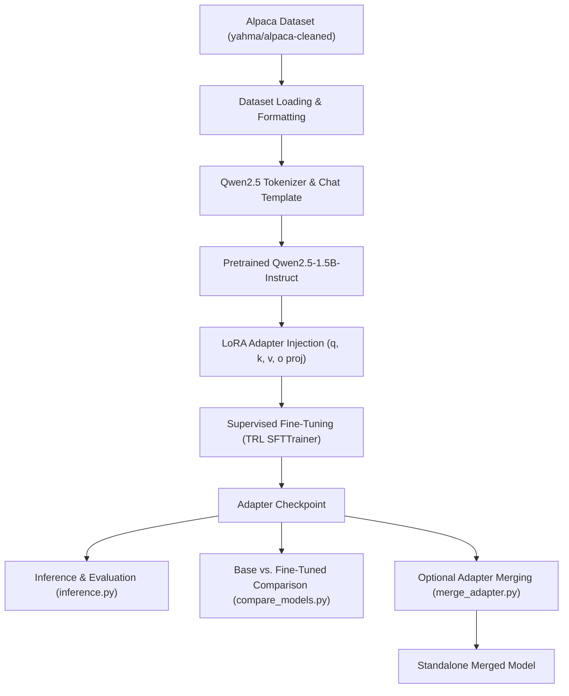
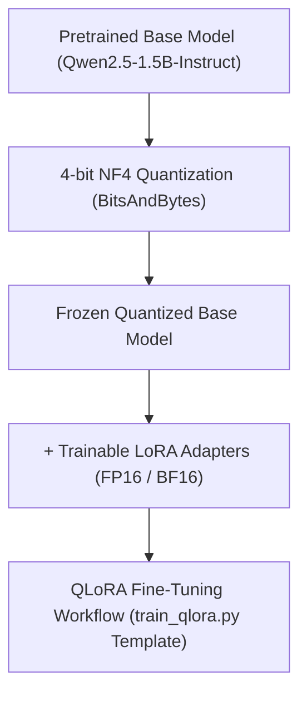

## Overview

Adapting general-purpose foundational models to specific domains or instruction formats traditionally required full parameter fine-tuning. For models with billions of parameters, full fine-tuning demands prohibitive GPU memory because optimizers like AdamW must maintain 32-bit master weights, momentum states, and variance states for every single parameter in the model (often requiring 16–24 bytes of memory per parameter).

**Parameter-Efficient Fine-Tuning (PEFT)** addresses this bottleneck. Instead of updating all parameters, methods like **Low-Rank Adaptation (LoRA)** freeze the pretrained base model weights and inject small, trainable low-rank decomposition matrices into targeted attention layers:

$$W = W_0 + \Delta W = W_0 + \frac{\alpha}{r} (B \cdot A)$$

where $W_0 \in \mathbb{R}^{d \times k}$ remains frozen, $A \in \mathbb{R}^{r \times k}$ is initialized with Gaussian noise, and $B \in \mathbb{R}^{d \times r}$ is initialized to zero, with rank $r \ll \min(d, k)$.

**Quantized Low-Rank Adaptation (QLoRA)** further compresses memory by quantizing the frozen base model to 4-bit NormalFloat (NF4) representations and computing gradients through backpropagation into full-precision adapter matrices.

This project implements a modular, clean supervised fine-tuning pipeline tailored for **Qwen2.5-1.5B-Instruct**, structuring end-to-end stages from tokenization and chat-template formatting to adapter inference, side-by-side model comparison, and weight merging.

## Architecture

### Data Flow Walkthrough

1. **Dataset Loading & Formatting:** Instructions and inputs from the `yahma/alpaca-cleaned` dataset are parsed and converted into conversational roles (`system`, `user`, `assistant`).
2. **Chat Template Tokenization:** The Qwen2.5 tokenizer applies the official `<|im_start|>` and `<|im_end|>` special token boundaries.
3. **Model Preparation & LoRA Injection:** The pretrained `Qwen/Qwen2.5-1.5B-Instruct` model is loaded in 16-bit precision. Low-rank adapter matrices are injected exclusively into the query, key, value, and output projection layers of each attention head.
4. **Supervised Fine-Tuning:** The model is trained using TRL's `SFTTrainer` with gradient accumulation. Only adapter parameters receive gradients.
5. **Adapter Checkpointing & Post-Training:** The lightweight adapter weights are saved independently (~30–50 MB). They can be directly loaded onto the base model during inference, evaluated side-by-side with `compare_models.py`, or fused into the base model weights with `merge_adapter.py`.

### QLoRA Template Workflow

In addition to standard LoRA fine-tuning, the repository provides a template configuration for 4-bit quantized training:

*Note: The QLoRA pipeline is provided as a configured template in `train_qlora.py` for low-memory environments, while `train_lora.py` represents the primary standard training entry point.*

## Model and Adapter Architecture

- **Base Foundation Model:** [`Qwen/Qwen2.5-1.5B-Instruct`](https://huggingface.co/Qwen/Qwen2.5-1.5B-Instruct)
- **Target Attention Projections:**
  - `q_proj` (Query projection)
  - `k_proj` (Key projection)
  - `v_proj` (Value projection)
  - `o_proj` (Output attention projection)

The base transformer parameters—including all self-attention weights, MLP layers (`gate_proj`, `up_proj`, `down_proj`), layer norms, and the language-modeling head—remain strictly **frozen**. Only the inserted low-rank matrix pairs ($A$ and $B$) across the four target projection layers are updated during backpropagation, reducing trainable parameters to a tiny fraction of the total model size.

## LoRA Configuration

The documented training parameters configured in the repository:

| Parameter | Value | Description |
|---|---|---|
| **LoRA Rank ($r$)** | `16` | Dimension of the low-rank decomposition matrices |
| **LoRA Alpha ($\alpha$)** | `32` | Scaling factor applied to the adapter updates ($\alpha / r = 2.0$) |
| **LoRA Dropout** | `0.05` | Dropout probability for adapter layers during training |
| **Target Modules** | `q_proj, k_proj, v_proj, o_proj` | Attention projection linear layers |
| **Bias** | `none` | No bias terms are trained |
| **Task Type** | `CAUSAL_LM` | Causal language modeling objective |
| **Learning Rate** | `2e-4` | Peak learning rate with warmup |
| **Epochs** | `1` | Single pass over instruction dataset |
| **Per-Device Batch Size** | `2` | Batch size per GPU step |
| **Gradient Accumulation** | `8` | Number of forward steps before backward update |
| **Effective Batch Size** | `16` | Total samples per optimizer step ($2 \times 8$) |
| **Trainer Engine** | TRL `SFTTrainer` | Supervised Fine-Tuning trainer from Hugging Face |

*Note: The table above reflects the documented configuration settings, not measured experimental outcomes.*

## Training Pipeline

The repository organizes training and data processing into modular utility components:

- **Dataset Ingestion & Formatting:**
  - [`utils/dataset.py`](https://github.com/themdanas/Fine-tuning-Qwen2.5-1.5B-Instruct-with-LoRA-and-QLoRA/blob/main/utils/dataset.py) loads the `yahma/alpaca-cleaned` instruction dataset.
  - [`utils/formatting.py`](https://github.com/themdanas/Fine-tuning-Qwen2.5-1.5B-Instruct-with-LoRA-and-QLoRA/blob/main/utils/formatting.py) maps raw `instruction`, `input`, and `output` fields into standard message dictionaries formatted for Qwen chat templates.
- **Model Loader & Trainer Configuration:**
  - [`utils/model.py`](https://github.com/themdanas/Fine-tuning-Qwen2.5-1.5B-Instruct-with-LoRA-and-QLoRA/blob/main/utils/model.py) initializes the base model, configures PEFT `LoraConfig`, and attaches adapters.
  - [`utils/trainer.py`](https://github.com/themdanas/Fine-tuning-Qwen2.5-1.5B-Instruct-with-LoRA-and-QLoRA/blob/main/utils/trainer.py) configures `TrainingArguments` and initializes the TRL `SFTTrainer`.
  - [`configs/train_config.py`](https://github.com/themdanas/Fine-tuning-Qwen2.5-1.5B-Instruct-with-LoRA-and-QLoRA/blob/main/configs/train_config.py) centralizes hyperparameters.
- **Entry Points:**
  - [`train_lora.py`](https://github.com/themdanas/Fine-tuning-Qwen2.5-1.5B-Instruct-with-LoRA-and-QLoRA/blob/main/train_lora.py) serves as the primary standard fine-tuning entry point.
  - [`train_qlora.py`](https://github.com/themdanas/Fine-tuning-Qwen2.5-1.5B-Instruct-with-LoRA-and-QLoRA/blob/main/train_qlora.py) provides the 4-bit BitsAndBytes quantization template.

## Inference and Model Export

The project provides dedicated scripts for verifying, serving, and exporting fine-tuned checkpoints:

- **[`inference.py`](https://github.com/themdanas/Fine-tuning-Qwen2.5-1.5B-Instruct-with-LoRA-and-QLoRA/blob/main/inference.py):** Loads the base model, attaches the trained LoRA adapter directory, applies the Qwen chat template, and streams responses for interactive prompts.
- **[`compare_models.py`](https://github.com/themdanas/Fine-tuning-Qwen2.5-1.5B-Instruct-with-LoRA-and-QLoRA/blob/main/compare_models.py):** Prompts both the raw un-adapted base model and the adapter-enhanced model with identical generation settings (temperature, top-p, max tokens) to qualitatively inspect style and instruction compliance changes.
- **[`merge_adapter.py`](https://github.com/themdanas/Fine-tuning-Qwen2.5-1.5B-Instruct-with-LoRA-and-QLoRA/blob/main/merge_adapter.py):** Fuses adapter weights directly into the base model tensors using PEFT's `merge_and_unload()` method. This exports a standalone model that can be deployed to standard inference engines (like vLLM or Ollama) without requiring PEFT runtime dependencies.
- **[`sanity_check.py`](https://github.com/themdanas/Fine-tuning-Qwen2.5-1.5B-Instruct-with-LoRA-and-QLoRA/blob/main/sanity_check.py):** Verifies that forward and backward passes execute cleanly without CUDA out-of-memory errors on small dummy inputs before launching long training runs.
- **[`test.py`](https://github.com/themdanas/Fine-tuning-Qwen2.5-1.5B-Instruct-with-LoRA-and-QLoRA/blob/main/test.py):** Verifies hardware, PyTorch CUDA availability, and installed library versions.

## Technical Concepts

### Parameter-Efficient Fine-Tuning (PEFT)
PEFT encompasses techniques that freeze the overwhelming majority of a model's weights and update only a small subset of parameters. This drastically lowers gradient storage requirements, allows rapid multi-task adapter switching at inference time, and prevents catastrophic forgetting.

### Low-Rank Adaptation (LoRA)
Hypothesizes that weight updates during adaptation have a low "intrinsic dimension". Decomposing updates into two smaller matrices $B \times A$ reduces memory and parameter count from $d \times k$ to $r \times (d + k)$.

### 4-Bit NormalFloat (NF4) & QLoRA
An information-theoretically optimal quantile quantization data type for zero-mean, unit-variance normally distributed neural network weights, enabling base models to fit in less than half their standard FP16 footprint.

### Adapter Merging
Because matrix addition is linear ($W = W_0 + \Delta W$), trained adapter matrices can be permanently added into the base weights prior to deployment. This eliminates any runtime latency penalty during token generation.

## Evaluation

Evaluation results will be added after reproducible training runs and model comparisons.

## Limitations and Future Work

### Current Status
- **Implemented:** Modular dataset formatting, Qwen chat template integration, LoRA configuration, training pipeline (`train_lora.py`), sanity checking, adapter inference, model comparison utility, and weight merging script.
- **Documented Template:** QLoRA 4-bit training workflow configured in `train_qlora.py`.

### Planned Future Work
- Execute and benchmark full training runs across varying LoRA rank values ($r \in \{8, 16, 32\}$).
- Profile peak GPU VRAM consumption comparing LoRA against 4-bit QLoRA.
- Implement quantitative instruction-following evaluation using MT-Bench or AlpacaEval.
- Add automated regression tests verifying generation formatting consistency.
