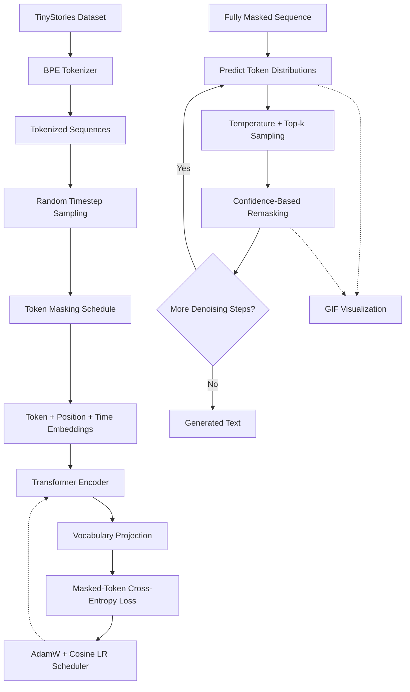

## Overview

Unlike conventional autoregressive language models (such as GPT) that generate text strictly from left to right, **Tiny Diffusion Language Model** is a discrete diffusion model built from scratch in **PyTorch** and **Transformer Encoders**, trained on the [TinyStories](https://huggingface.co/datasets/roneneldan/TinyStories) dataset. Instead of predicting the next token sequentially, it generates text through global, iterative denoising across bidirectional self-attention layers.

### Motivation

Standard autoregressive language modeling enforces a strict causal constraint: each token $x_i$ can only attend to prior tokens $x_{<i}$. While effective, this creates inherent limitations:
- **Exposure Bias & Error Compounding:** An early suboptimal prediction permanently corrupts the remaining sequence without any mechanism to backtrack or revise.
- **Strict Sequential Bottleneck:** Generation latency scales linearly with sequence length $O(N)$, requiring $N$ sequential forward passes.
- **Unidirectional Planning:** Autoregressive models cannot condition generation on both past and future structural constraints simultaneously.

**Discrete Diffusion Language Models** reformulate text generation as an iterative denoising process. Starting from complete noise (a sequence composed entirely of `[MASK]` tokens), the model refines the entire sequence globally across discrete timesteps, using bidirectional attention to resolve high-level narrative structure first and refine local grammar later.

### What is Implemented

1. **Custom Byte-Pair Encoding (BPE) Tokenizer:** Trained from scratch on TinyStories with an 8,000-token vocabulary and dedicated special tokens (`[PAD]`, `[UNK]`, `[MASK]`).
2. **Bidirectional Transformer Encoder Architecture:** ~13.84M parameters across 6 layers and 6 attention heads, featuring learned diffusion timestep conditioning and weight tying between embeddings and the vocabulary projection head.
3. **Discrete Corruption Pipeline:** Forward diffusion process corrupting token sequences according to a linear masking schedule across 64 discrete timesteps.
4. **Masked-Token Objective:** Computes cross-entropy loss exclusively on corrupted positions, excluding padding and unmasked context.
5. **Iterative Predict-and-Remask Inference:** Employs temperature-scaled top-$k$ candidate sampling with confidence-based remasking, allowing the model to dynamically revise uncertain predictions across denoising steps.
6. **Retro Terminal Generation Visualizer:** Custom rendering pipeline built with **Pillow** and **ImageIO** that records the evolving denoising trajectory into an animated retro-futuristic terminal GIF.

## Architecture



### Forward Pass Data Flow

1. **Tokenization:** Text sequences from the TinyStories corpus are encoded into integer token indices $x_0 \in \{0, \dots, V-1\}^L$ of maximum length $L = 256$.
2. **Timestep Sampling:** During training, a diffusion timestep $t \sim \mathcal{U}(1, T)$ is sampled uniformly at random for each sequence, where total timesteps $T = 64$.
3. **Linear Masking Schedule:** Tokens are corrupted into the absorbing state `[MASK]` with probability $\gamma(t) = t / T$.
4. **Tri-Partite Embedding Projection:** Input representations combine three independent embedding spaces:
   $$E = E_{\text{token}}(x_t) + E_{\text{pos}}(p) + E_{\text{time}}(t)$$
   where $E_{\text{time}}(t)$ injects learned temporal awareness of current corruption level into every sequence position.
5. **Bidirectional Attention:** The sequence passes through 6 Transformer Encoder blocks with unconstrained self-attention, allowing every position to attend to all unmasked and masked tokens simultaneously.
6. **Vocabulary Projection & Loss:** The final hidden states are projected back to vocabulary logits through tied weights. Cross-entropy loss is computed strictly on positions where $x_t = \text{[MASK]}$ and $x_0 \ne \text{[PAD]}$.

## How It Works

Unlike continuous diffusion models (such as Stable Diffusion or DDPM) that operate over continuous latent representations with Gaussian noise perturbations, language tokens live in a discrete, categorical space.

- **Discrete Diffusion:** Corrupts token sequences using an absorbing-state masking schedule. Rather than adding Gaussian noise to continuous vectors, tokens are replaced with a special `[MASK]` token.
- **Transformer Encoder:** Uses bidirectional self-attention to learn context from both directions simultaneously, capturing bidirectional syntactic and semantic dependencies.
- **Timestep Conditioning:** Adds learned diffusion timestep embeddings to token and positional embeddings, signaling to the network what stage of noise reduction it is currently performing.
- **Masked-Token Objective:** Computes cross-entropy loss only on corrupted tokens, preventing the network from trivializing the task by predicting uncorrupted input tokens.
- **Iterative Generation:** Generates text by starting with pure masks, predicting full vocabulary distributions, sampling candidate tokens, and remasking low-confidence positions over multiple denoising steps.
- **Generation Visualization:** Renders the evolving sequence as an animated retro terminal-style GIF (`inference_cool.gif`).

## Model Architecture

| Component | Configuration |
|---|---|
| **Architecture** | Transformer Encoder (Bidirectional) |
| **Parameters** | ~13.84M |
| **Transformer layers** | 6 |
| **Attention heads** | 6 |
| **Hidden dimension ($d_{\text{model}}$)** | 384 |
| **Intermediate FFN dimension** | 1,536 ($4 \times d_{\text{model}}$) |
| **Maximum sequence length** | 256 tokens |
| **Vocabulary size** | 8,000 |
| **Diffusion timesteps ($T$)** | 64 |
| **Tokenizer** | Custom BPE, trained from scratch |
| **Weight Tying** | Shared token embedding matrix & LM projection head |

**Weight Tying:** The token embedding matrix ($8,000 \times 384$) is directly reused as the linear language modeling projection head. This removes redundant parameters (~3.07M), stabilizes representations, and prevents the head from drifting from embedding space.

## Training Pipeline

1. **Tokenizer Training:** A custom Byte-Pair Encoding (BPE) tokenizer is trained from scratch on raw TinyStories narratives using Hugging Face `tokenizers`, producing an optimized 8,000-token vocabulary with minimal subword fragmentation.
2. **Sequence Corruption:** A random diffusion timestep $t \in [1, 64]$ is sampled for each batch item. Tokens are masked according to a linear schedule $\gamma(t)$, simulating intermediate noise states.
3. **Denoising Objective:** The network predicts the original ground-truth tokens $x_0$ at all corrupted positions using cross-entropy loss:
   $$\mathcal{L}(\theta) = - \frac{1}{|\mathcal{M}_t|} \sum_{i \in \mathcal{M}_t} \log P_\theta(x_{0, i} \mid x_t, t)$$
   where $\mathcal{M}_t$ denotes the set of masked indices.
4. **Optimization:** Trained using AdamW with $\beta_1 = 0.9$, $\beta_2 = 0.98$, weight decay of $0.01$, learning rate warmup, and cosine decay annealing.
5. **Mixed Precision:** Uses **Hugging Face Accelerate** for distributed-ready training and FP16 execution, optimizing memory throughput and training velocity.

## Inference and Generation Mechanics

Generation starts with an entirely masked sequence of length $L$:
$$x_T = [\text{[MASK]}, \text{[MASK]}, \dots, \text{[MASK]}]$$

At each denoising step $s$ from $t = T$ down to $1$:

1. **Forward Pass:** The complete sequence $x_t$ and timestep $t$ are passed through the Transformer Encoder.
2. **Distribution Estimation:** The model outputs probability distributions across the 8,000-token vocabulary for all positions.
3. **Stochastic Sampling:** Candidate tokens are sampled using temperature scaling and top-$k$ filtering to balance diversity and fluency.
4. **Confidence-Based Remasking:** For each sampled token, its prediction probability serves as a confidence score:
   $$c_i = P_\theta(\hat{x}_{0, i} \mid x_t, t)$$
   According to the scheduled noise level for the subsequent step $\gamma(t - 1)$, the positions with the lowest confidence scores are re-masked to `[MASK]`, while high-confidence predictions are retained.
5. **Iterative Refinement:** Steps 1–4 repeat until $t = 0$. In the final step, all remaining positions are committed, and the sequence is decoded back into text.

This predict-and-remask strategy allows uncertain positions to be revised iteratively instead of permanently committing to every prediction immediately.

## Generation Visualization

The repository includes a custom GIF visualizer that records the model's intermediate thinking states and denoising trajectory:

- **Pillow (PIL):** Draws retro terminal frames with glowing green neon typography, scanlines, CRT screen curvature styling, and step progress indicators.
- **ImageIO:** Assembles individual frames into an animated GIF (`inference_cool.gif`).
- **Step-by-Step Trajectory:** Visually illustrates how abstract sentence structure forms early (subject and predicate tokens), while detailed nouns, adjectives, and punctuation crystallize in later denoising steps.

## Technical Concepts and First Principles

### Discrete vs. Continuous Diffusion
In continuous diffusion (e.g., DDPM for images), noise is Gaussian perturbations added in continuous vector space. In discrete token spaces, adding Gaussian noise to one-hot vectors or token embeddings pushes vectors off the discrete manifold into semantically undefined regions. Absorbing state diffusion solves this by treating corruption as a categorical transition to an explicit `[MASK]` token, where the model learns the conditional distribution $q(x_0 \mid x_t, t)$.

### Bidirectional Self-Attention vs. Causal Attention
Autoregressive models use lower-triangular causal masks, preventing token $i$ from seeing tokens $j > i$. Discrete diffusion uses bidirectional self-attention: when predicting a masked verb in the middle of a sentence, the model conditions simultaneously on the preceding subject and the succeeding object, yielding strong global consistency.

### Non-Monotonic Decoding
Traditional left-to-right generation is monotonic: token 1 is fixed before token 2 is sampled. Discrete diffusion with remasking is non-monotonic: an ambiguous word sampled at step 40 can be re-masked at step 35 if subsequent contextual tokens reveal a contradiction, effectively giving the model an explicit self-correction mechanism.

## Engineering Decisions and Trade-offs

### Decision 1: Absorbing Mask Token vs. Uniform Replacement
- **Decision:** Use an absorbing `[MASK]` state schedule rather than uniform random token substitution.
- **Reasoning:** Random token substitution introduces adversarial semantic distortion, confusing training signals. Absorbing masks explicitly indicate missing information without corrupting vocabulary priors.
- **Trade-off:** Requires a dedicated mask token in the vocabulary.

### Decision 2: Weight Tying Token Embeddings with LM Head
- **Decision:** Bind the input token embedding matrix directly to the final vocabulary projection weights.
- **Reasoning:** Reduces model size from ~16.91M to ~13.84M parameters (saving 3.07M parameters) and ensures gradient signals from loss computation directly update token input vectors.
- **Trade-off:** Constrains hidden dimension $d_{\text{model}}$ to match output projection dimension.

### Decision 3: Linear Timestep Masking Schedule
- **Decision:** Adopt a linear masking schedule $\gamma(t) = t / T$ over 64 discrete timesteps.
- **Reasoning:** Provides uniform difficulty progression across training steps and simple, stable remasking thresholds during inference.
- **Trade-off:** Cosine or mutual-information-based schedules may offer slight edge-case improvements, which are earmarked for future benchmarking.

## Implementation Details

```python
# Embedding Layer with Learned Timestep Conditioning
class DiffusionEmbedding(nn.Module):
    def __init__(self, vocab_size: int, d_model: int, max_seq_len: int, num_timesteps: int):
        super().__init__()
        self.token_embed = nn.Embedding(vocab_size, d_model)
        self.pos_embed = nn.Embedding(max_seq_len, d_model)
        self.time_embed = nn.Embedding(num_timesteps + 1, d_model)
        self.norm = nn.LayerNorm(d_model)

    def forward(self, x: torch.Tensor, timesteps: torch.Tensor) -> torch.Tensor:
        seq_len = x.size(1)
        positions = torch.arange(seq_len, device=x.device).unsqueeze(0)
        
        tok_e = self.token_embed(x)
        pos_e = self.pos_embed(positions)
        time_e = self.time_embed(timesteps).unsqueeze(1)  # (B, 1, d_model)
        
        return self.norm(tok_e + pos_e + time_e)
```

```python
# Confidence-Based Remasking Step During Inference
@torch.no_grad()
def p_sample_step(model, x_t, t, temperature=0.8, top_k=50):
    logits = model(x_t, t)  # (B, L, V)
    logits = logits / temperature
    
    # Filter top-k
    indices_to_remove = logits < torch.topk(logits, top_k)[0][..., -1, None]
    logits[indices_to_remove] = -float("Inf")
    
    probs = F.softmax(logits, dim=-1)
    sampled_tokens = torch.multinomial(probs.view(-1, probs.size(-1)), 1).view(x_t.shape)
    confidences = torch.gather(probs, -1, sampled_tokens.unsqueeze(-1)).squeeze(-1)
    
    return sampled_tokens, confidences
```

## Tech Stack

`Python` · `PyTorch` · `Hugging Face Tokenizers` · `Transformers` · `Accelerate` · `Pillow` · `ImageIO`

## Key Learning Outcomes

- Implementing a discrete diffusion objective for language modeling from first principles.
- Building and training a Transformer Encoder with learned timestep conditioning.
- Understanding discrete corruption schedules and absorbing-state diffusion.
- Designing iterative denoising, temperature-scaled sampling, and confidence-based remasking.
- Visualizing intermediate model predictions and denoising trajectories dynamically.

## Future Improvements

- **Masking Schedules:** Benchmark cosine, square-root, and mutual-information noise schedules against the linear baseline.
- **Latency Benchmarks:** Quantitatively profile generation throughput and latency against autoregressive baselines (such as GPT-2 / TinyStories AR).
- **Alternative Sampling & Remasking:** Experiment with entropy-based remasking and classifier-free guidance for text diffusion.
- **Quantitative Evaluation:** Measure perplexity, BLEU, and diversity metrics alongside human preference evaluation.
